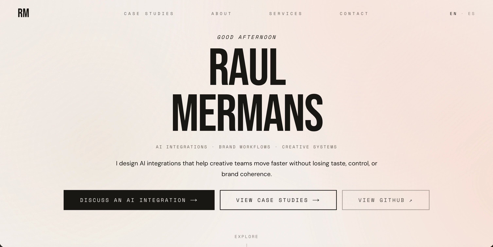

<div align="center">

# RAÚL MERMANS — PORTFOLIO

**Engineering, product thinking, and visual storytelling in one place.**

A bilingual, editorial portfolio for applied AI systems, software products, and creative work — designed and built with Next.js.

[](https://www.raulmermans.com/en/)
[](https://nextjs.org/)
[](https://www.typescriptlang.org/)



<sub>Project preview from the portfolio's own visual assets.</sub>

**[Live portfolio](https://www.raulmermans.com/en/)** · **[Case studies](https://www.raulmermans.com/en/case-studies/)** · **[Visual work](https://www.raulmermans.com/en/visuals/)** · **[Architecture](docs/PORTFOLIO_EXPERIENCE_SYSTEM.md)**

</div>

---

## At a glance

| Experience | Engineering | Delivery |
|:--|:--|:--|
| Spanish / English routes, editorial case studies, photography and visual archive | Next.js 16, React 19, TypeScript, custom design system | Static export, CI verification, accessible end-to-end testing, SFTP deployment |

This is the source behind my personal website. It is **a working portfolio system, not a starter template**: project narratives, localized content, responsive media, metadata, and deployment checks live in one repository.

The engineering challenge is to make an expressive, image-heavy experience work as reliable, statically hosted software — with explicit route contracts, responsive image derivatives, and automated checks before release.

**Scope:** Source code is MIT-licensed; creative assets, copy, photography, and personal identity work remain separately protected. See [License](#license) and [Asset Usage](#asset-usage).

---

## Tech Stack

- Next.js 16 with the App Router and React 19
- TypeScript
- Tailwind CSS and custom global CSS
- Static export-ready build output

## Key Features

- Server-rendered Spanish default routes and English `/en/` routes
- Case study system for AI systems, automation, brand, and product work
- Photography and visual archive sections
- App and prototype pages with shared metadata helpers
- Static-safe contact flow using the visitor's email client
- SEO helpers, sitemap, robots, manifest, and structured data

## Case Study System

Case studies are driven by route files under `app/(es)/case-studies/` and
shared data in `data/`. Each case study combines narrative copy, project metadata,
localized UI text, and assets from `public/images/case-studies/`.

The public repository keeps the portfolio implementation visible while
preserving ownership of the creative assets and project narratives.

## Local Setup

```bash
npm install
npm run dev
```

Open `http://localhost:3000` to view the site locally.

## Build

```bash
npm run lint
npm run type-check
npm run build
npm run verify:export
npm run verify:canonical
```

The project is configured for static export via `next.config.js`.

## Deployment

Cloudflare Pages builds the static export from pushes to `main` through its
GitHub integration. Its build command verifies the export, canonical URLs, and
Pages asset limits before publishing `out/`. GitHub Actions runs independent
type, lint, build, and browser checks. IONOS remains the domain registrar.

Domain cutover and rollback are documented in
[the migration runbook](docs/cloudflare-pages-migration.md).

## Canonical architecture

- Spanish is the canonical default: `/about/`, `/case-studies/`, and related routes.
- English equivalents live below `/en/`.
- Historical `/es/*` URLs use `public/_redirects` on Cloudflare Pages.
- Each localized page emits its own server-rendered `lang`, canonical URL,
  `en-US`, `es-ES`, and `x-default` alternates.
- The document schema begins with stable Person and WebSite entities; page-level
  entities connect back to those IDs.

## Image strategy

Static hosting keeps Next's runtime image optimizer disabled. `npm run build`
generates WebP and AVIF photography derivatives at 480, 768, 1200, 1600, and
2400 pixels when the source is large enough. The gallery uses responsive
`srcset` markup, and generated assets are deliberately ignored by Git.

## Analytics

GA4 is optional and runs only in production when `NEXT_PUBLIC_GA_MEASUREMENT_ID`
is set. Initialization disables GA's automatic page view; the client records one
explicit page view for each SPA navigation. Consent collection, if required for
the deployment's audience, must be supplied separately from this event logic.

Local/private deployment helper scripts are intentionally ignored.

## Environment

`.env.example` lists the public template variables. Do not commit real `.env` files.

## License

Source code is licensed under MIT. Creative assets, photography, case study
imagery, copywriting, brand systems, project narratives, and personal identity
materials are not open licensed.

## Asset Usage

Do not copy, redistribute, remix, reuse, or commercially use the visual assets,
photography, case study materials, or personal identity work without explicit
written permission.

## Public Repo Note

This repository is published as a portfolio source reference. It is not a
starter template, client deliverable, or reusable asset pack.
